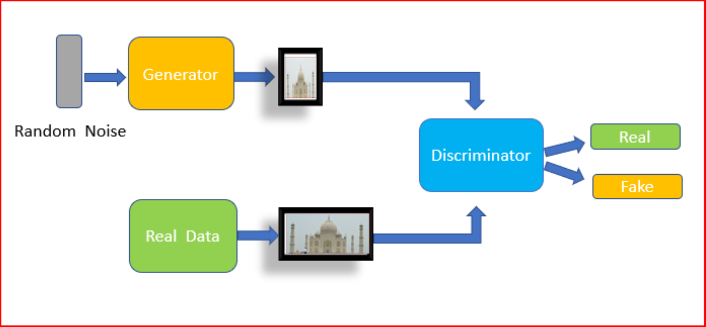
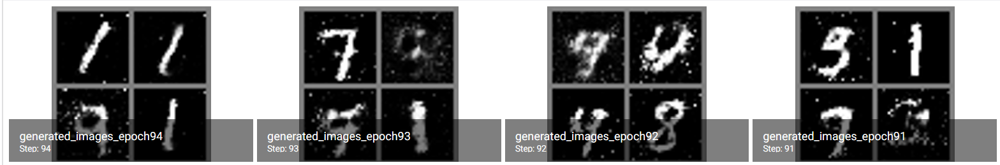
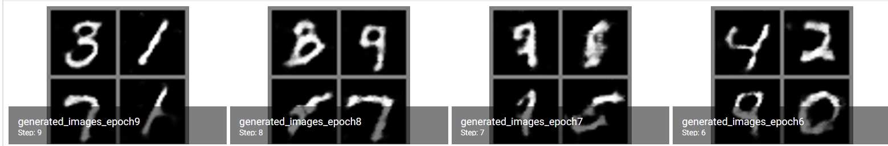
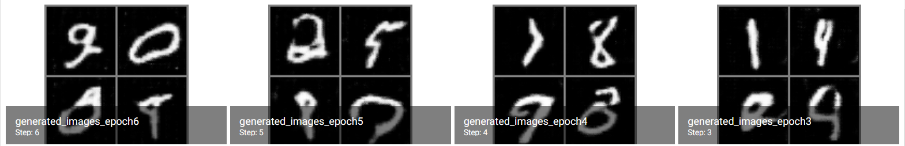
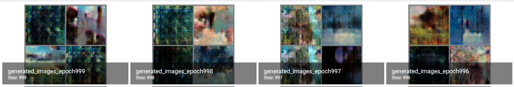
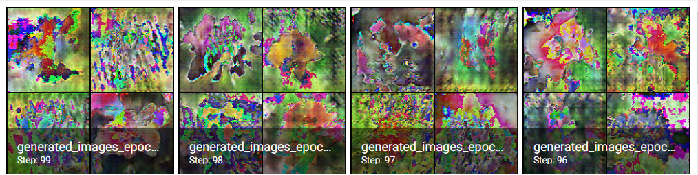
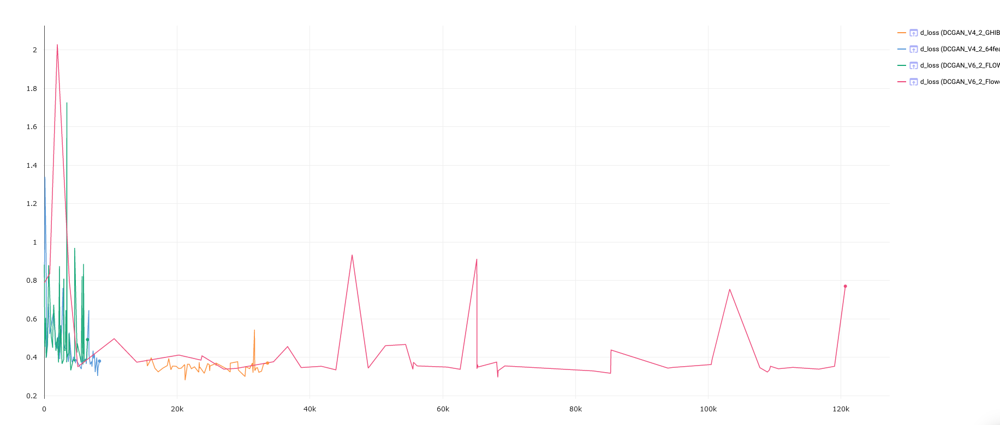
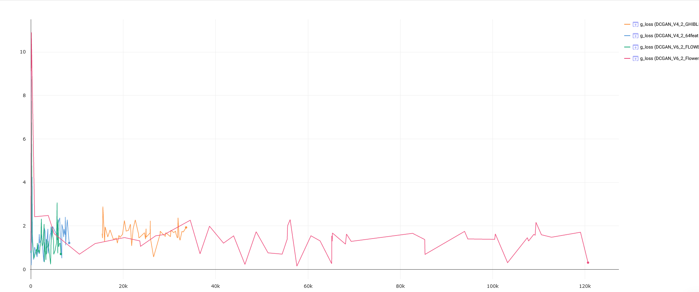

# Generative Adversarial Network

> In this project, I experimented with getting a Generative Adversarial Network (GAN) to work.

   

---

## 📌 Project Description

**Setup:**
I used PyTorch and PyTorch Lightning as the framework. The datasets used were:

* **MNIST** (handwritten digit dataset)
* **IRIS Flower dataset**
* A custom **GHIBLI dataset** (hand-drawn landscape images from Studio Ghibli)

**Goal:**
The objective was to generate images that resemble the dataset inputs. For instance, when training on the MNIST dataset, the aim was to generate images that look like handwritten digits.

**Model Architectures:**
I explored different architectures and fine-tuned them. The models used included:

* **Generative Adversarial Network (GAN):**
  A basic architecture using a Multi-Layer Perceptron (MLP), with a **Discriminator** that attempts to detect fake images and a **Generator** that attempts to produce realistic-looking images to fool the Discriminator.

* **Deep Convolutional Generative Adversarial Network (DCGAN):**
  Uses convolutional layers (commonly used in image classification) to improve image realism.

* **Conditional Deep Convolutional GAN (CDC-GAN):**
  Uses both the image and metadata (e.g., labels) to condition the generation process.

**Training Tricks & Techniques:**

* [Instance Noise](https://www.inference.vc/instance-noise-a-trick-for-stabilising-gan-training/)
* Soft labels
* Experience replay
* More tricks:

  * [Soumith’s GAN hacks](https://github.com/soumith/ganhacks)
  * [GAN training pitfalls and tips](https://medium.com/@utk.is.here/keep-calm-and-train-a-gan-pitfalls-and-tips-on-training-generative-adversarial-networks-edd529764aa9)
  * [Training GANs faster & better](https://medium.com/intel-student-ambassadors/tips-on-training-your-gans-faster-and-achieve-better-results-9200354acaa5)

**More Resources:**

* [Original GAN paper (Goodfellow)](https://arxiv.org/abs/1406.2661)
* [DCGAN paper](https://arxiv.org/abs/1511.06434)
* [Conditional GAN paper](https://arxiv.org/abs/1411.1784)
* [PyTorch DCGAN tutorial](https://pytorch.org/tutorials/beginner/dcgan_faces_tutorial.html)

---

## ▶️ Usage

1. Download the Jupyter Notebook files (`.ipynb`) you want to use from the `code` folder.
2. Run them with Jupyter Notebook/Lab or Google Colab.

**Notes:**

* On **Google Colab**, all necessary packages should auto-install.
* On a **local Jupyter Notebook**, you’ll need to install required packages manually.
* Please read the **Disclaimer** below.

---

## ⚠️ Disclaimer

This project was created a while ago and the documentation is not very organized. As a result, there are multiple Jupyter Notebooks with vague naming, and differences are not always clearly explained.

When selecting a notebook, **inspect both the filename and the code**.

Some notebooks may require tinkering before they work. Here’s why:

* Some notebooks do **not train from scratch** (Epoch 0) but attempt to **load from a checkpoint** (e.g., Epoch 50 or 100).
  → To fix: comment out `resume_from_checkpoint=""` in the `pl.Trainer()` call.

* Some models are trained using a **custom GHIBLI dataset**.
  → To use another dataset, modify the `train_dataloader` and `test_dataloader` functions. Be mindful of **image sizes** when doing so.

* The logger used is `comet_ml`, but I removed my API key.
  → Replace with your own `comet_ml` API key or use a different logging method.

* There may be other issues I don’t currently remember.

---

## ✅ Results

I was able to generate convincing digit images in various resolutions, including 16×16, 32×32, 64×64, and 128×128 (via upscaled MNIST).
However, results for the **flower** and **GHIBLI** datasets were less successful.

### ✔ Implemented Models

* [x] Standard MLP (GAN on MNIST)
  

* [x] Standard DCGAN
  

* [x] DCGAN with training tricks
  

* [x] DCGAN with colored GHIBLI landscape images (64×64)
  

* [x] DCGAN with flower images (128×128)
  

### 📉 Loss Graphs

* **Discriminator Loss**
  

* **Generator Loss**
  

👉 [Click here to see more results and loss graphs](https://www.comet.ml/luposx#projects)

---

## 📄 License

Distributed under the MIT License.
See [`LICENSE`](https://github.com/LuposX/BostonHousingPrediction/blob/master/LICENSE) for more information.
